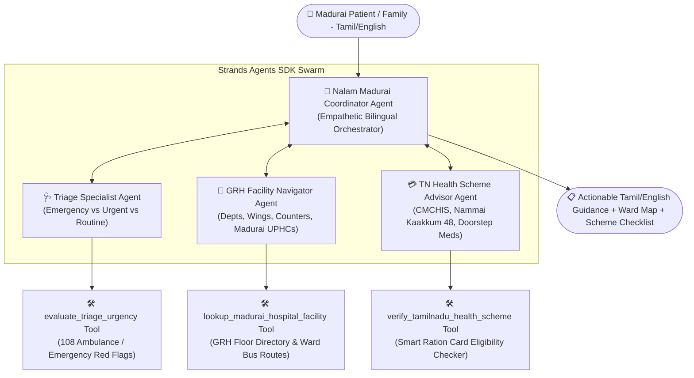

# 🏥 நலம் மதுரை (Nalam Madurai)
### AI-Powered Multi-Agent Community Health & GRH Hospital Navigator for Madurai

> **Track:** Health (AI for Social Good)  
> **Platform:** AWS User Group Madurai Hackathon — Strands SDK: Workshop to Ship  
> **Built With:** **Strands Agents SDK**, **Amazon Bedrock**, Python, Multi-Agent Swarm Architecture

---

## 📌 Problem Statement

In **Madurai and surrounding southern districts of Tamil Nadu**, thousands of rural, semi-urban, and elderly citizens arrive daily at the landmark **Government Rajaji Hospital (GRH Madurai)** or local **Urban Primary Health Centres (UPHCs)**. 

However, patients face recurring hurdles:
1. **Hospital Navigational Confusion:** GRH Madurai is a massive 2,500+ bed medical campus with multiple disparate complexes (Panagal Road Main Wing, Super Speciality Block, Institute of Child Health, Trauma Care). First-time visitors struggle to locate the right department and OPD counters.
2. **Delayed Emergency Response:** Lack of clear triage guidance prevents families from identifying red-flag symptoms (e.g. cardiac distress vs. acidity) or calling the **108 ambulance** immediately.
3. **Unclaimed Government Schemes:** Many underprivileged families are unaware of life-saving Tamil Nadu welfare benefits like **CMCHIS** (up to ₹5 Lakhs free treatment), **Innuyir Kaappom - Nammai Kaakkum 48** (free accident trauma care for 48 hours without documentation), and **Makkalai Thedi Maruthuvam** (doorstep chronic medication).
4. **Language & Dialect Barrier:** Digital health tools often lack authentic Tamil colloquial understanding and conversational warmth.

---

## 💡 The Solution: Nalam Madurai Swarm

**Nalam Madurai (நலம் மதுரை)** is an intelligent, bilingual (Tamil & English) healthcare concierge powered by a **Strands Multi-Agent Swarm (`strands.multiagent.Swarm`)**. 

Instead of a single monolithic prompt, Nalam Madurai deploys a coordinated team of specialized AI agents:



---

## 👥 Specialized Swarm Agents

| Agent Name | Role | Responsibilities | Custom Strands Tool |
| :--- | :--- | :--- | :--- |
| **`nalam_madurai_coordinator`** | Swarm Entry & Synthesizer | Welcomes users in respectful Madurai Tamil, coordinates inter-agent queries, and formats concise answers. | Orchestration |
| **`triage_specialist`** | Clinical Triage & Urgency | Categorizes concerns into **Red (Emergency)**, **Yellow (Urgent)**, or **Green (Routine)** and issues immediate safety steps. | `evaluate_triage_urgency` |
| **`grh_hospital_navigator`** | Hospital & Ward Locator | Pinpoints the exact wing, floor, token hours (7:30 AM–12:00 PM), and nearest Madurai UPHC (Sellur, K.Pudur, etc.). | `lookup_madurai_hospital_facility` |
| **`tn_scheme_advisor`** | Welfare Scheme Navigator | Identifies free coverage under CMCHIS, Nammai Kaakkum 48, or Dr. Muthulakshmi Reddy Maternity Scheme. | `verify_tamilnadu_health_scheme` |

---

## 🚀 Key Features

* **🌍 100% Madurai-Centric & Bilingual:** Tailored for local bus routes (Periyar Bus Stand, Mattuthavani MGR Bus Stand) and landmark hospital blocks.
* **🚨 108 Emergency Trigger:** Automatic red-flag detection for chest pain, stroke, and road accidents.
* **📜 Tamil Nadu Welfare Integration:** Instant document checklist (Smart Ration Card, Aadhaar, PICME) to claim free treatment without out-of-pocket debt.
* **⚡ Strands SDK Native:** Demonstrates Model-Driven execution, tool schemas with `@tool`, and collaborative multi-agent swarms.

---

## 🛠 Project Structure

```
nalam-madurai/
├── requirements.txt         # Dependencies (strands-agents, boto3, etc.)
├── main.py                  # CLI and demonstration runner with 4 test scenarios
├── swarm.py                 # Multi-Agent Swarm setup using Strands Agents SDK
├── tools/
│   ├── strands_tools.py     # Custom tools decorated with @tool for Strands LLM invocation
│   ├── hospital_data.py     # Authoritative GRH Madurai & Madurai UPHC directory
│   └── schemes_data.py      # Tamil Nadu Government health schemes knowledge base
└── README.md                # Project documentation and submission overview
```

---

## 💻 Quick Start & Running the Demo

### 1. Clone & Navigate
```bash
cd nalam-madurai
```

### 2. Install Dependencies
```bash
pip install -r requirements.txt
```

### 3. Run Pre-configured Test Scenarios
```bash
python main.py
```

### 4. Run in Interactive Mode
```bash
python main.py --interactive
```

---

## 🌟 Demo Walkthrough Scenarios Tested

1. **Cardiac Emergency in Goripalayam:**
   * *Query:* "ஐயா, எனக்கு நேற்றிலிருந்து நெஞ்சு பாரமாகவும் மூச்சு திணறலாகவும் இருக்கிறது..."
   * *Action:* Triggers **`EMERGENCY_RED`**, directs to 108 ambulance & GRH 24x7 Trauma Casualty on Panagal Road, Super Speciality Block 2nd Floor Cardiology, under CMCHIS.
2. **Motherhood & Delivery Navigation in Sellur:**
   * *Query:* "கர்ப்பிணி பெண்ணுக்கு பிரசவம் பார்க்க ராஜாஜி மருத்துவமனையில் எந்த பிளாக்குக்கு செல்ல வேண்டும்?..."
   * *Action:* Directs to GRH Maternity Block / Institute of Child Health and explains the ₹18,000 **Dr. Muthulakshmi Reddy Maternity Benefit Scheme**.
3. **Bypass Road Accident & Trauma:**
   * *Query:* "மதுரை பைபாஸ் ரோட்டில் பைக் விபத்து. பலத்த காயம்..."
   * *Action:* Immediately triggers **Innuyir Kaappom - Nammai Kaakkum 48** (₹1 Lakh free trauma care for 48 hours without needing any initial documents).
4. **Elderly Diabetes & BP Doorstep Care:**
   * *Query:* "எங்கள் தாத்தாவுக்கு சர்க்கரை மற்றும் ரத்தக் கொதிப்பு உள்ளது..."
   * *Action:* Activates **Makkalai Thedi Maruthuvam** to arrange doorstep medicine delivery through the local K. Pudur / Sellur UPHC.

---

## 🏆 Hackathon Submission Checklist

- [x] Built specifically for the **Health / Social Good Track**
- [x] Multi-Agent Swarm architecture implemented with **Strands Agents SDK**
- [x] Custom tools defined using `@tool` with type hints and docstrings
- [x] Solves a real, localized community challenge for the people of Madurai
- [x] Ready to deploy on **Amazon Bedrock**
