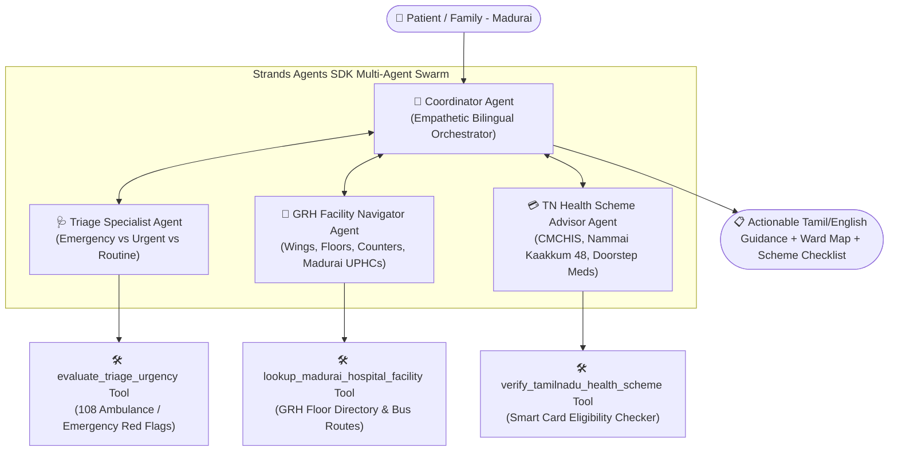

# 🏥 நலம் மதுரை (Nalam Madurai)
### AI-Powered Multi-Agent Community Health & GRH Hospital Navigator for Madurai

[](https://strandsagents.com/)
[](https://aws.amazon.com/bedrock/)
[](https://builder.aws.com/build/hackathons/8311dcb5-1ece-3d62-a441-2e1c2ad90b86/strands-sdk-workshop-to-ship)
[](https://swatiicfai.github.io/nalam-madurai/)


> 🌐 **Live Interactive Web Demo:** [**https://swatiicfai.github.io/nalam-madurai/**](https://swatiicfai.github.io/nalam-madurai/)  
> 🏆 **Event:** **AWS User Group Madurai** — *Strands SDK: Workshop to Ship (Oct 28 – Nov 4, 2026)*  
> 🎯 **Track:** **Health (AI for Social Good)**  
> 👩‍💻 **Builder / Author:** **Swati** ([@swatiicfai](https://github.com/swatiicfai))

---

## 📌 Executive Summary & Ground Challenge

In **Madurai and surrounding southern districts of Tamil Nadu**, over 9,000 rural and semi-urban patients arrive daily at the historic **Government Rajaji Hospital (GRH Madurai)** or local **Urban Primary Health Centres (UPHCs)**.

Families frequently face critical obstacles:
1. **Hospital Maze & Ward Navigation:** GRH Madurai spans multiple disconnected campuses (Panagal Road Main Block, Super Speciality Block, Institute of Child Health, Trauma Care). Patients arrive anxious and spend crucial hours asking around for the right OPD wing.
2. **Delayed Emergency Triage:** Without clear guidance, families often fail to recognize red-flag symptoms (cardiac discomfort, stroke symptoms, acute bleeding) or hesitate to call the **108 emergency ambulance**.
3. **Unclaimed Welfare Schemes:** Underprivileged families are frequently unaware of life-saving Tamil Nadu welfare benefits like:
   - **CMCHIS (Chief Minister's Comprehensive Health Insurance Scheme):** Up to ₹5 Lakhs free medical/surgical treatment per year.
   - **Innuyir Kaappom - Nammai Kaakkum 48:** 100% free emergency medical & surgical treatment up to ₹1,00,000 for the first 48 hours following a road accident, with **zero pre-documentation required**.
   - **Makkalai Thedi Maruthuvam:** Doorstep screening and chronic medication deliveries (BP, Diabetes) directly to homes.
   - **Dr. Muthulakshmi Reddy Maternity Benefit Scheme:** ₹18,000 financial & nutrition aid for institutional deliveries.
4. **Language & Dialect Barrier:** Existing digital health solutions lack authentic Tamil colloquial understanding and culturally grounded healthcare empathy.

---

## 💡 The Solution: Nalam Madurai Swarm

**Nalam Madurai (நலம் மதுரை)** is an intelligent, bilingual (Tamil & English) healthcare concierge built with the **Strands Agents SDK (`strands.multiagent.Swarm`)** and **Amazon Bedrock**.

Instead of a single monolithic prompt, Nalam Madurai orchestrates an autonomous team of specialized agents:



---

## 👥 Swarm Architecture & Agent Specializations

| Agent Name | Role | Responsibilities | Custom Strands Tool |
| :--- | :--- | :--- | :--- |
| **`nalam_madurai_coordinator`** | Swarm Entry & Synthesizer | Welcomes users in respectful Madurai Tamil, coordinates queries across specialized peers, and synthesizes actionable bilingual summaries. | Full Swarm Orchestration |
| **`triage_specialist`** | Clinical Triage & Urgency | Categorizes health complaints into **Red (Emergency)**, **Yellow (Urgent)**, or **Green (Routine)** and issues immediate safety steps. | `evaluate_triage_urgency` |
| **`grh_hospital_navigator`** | Hospital & Ward Locator | Pinpoints the exact wing, floor, token hours (7:30 AM–12:00 PM), and nearest Madurai UPHC (Sellur, K.Pudur, Teppakulam, etc.). | `lookup_madurai_hospital_facility` |
| **`tn_scheme_advisor`** | Welfare Scheme Navigator | Identifies free coverage under CMCHIS, Nammai Kaakkum 48, or Dr. Muthulakshmi Reddy Maternity Scheme and details required documents. | `verify_tamilnadu_health_scheme` |

---

## 🚀 Key Features

* **🌍 100% Madurai-Centric:** Grounded with real Madurai bus routes (Periyar Bus Stand, Mattuthavani MGR Bus Stand) and specific landmark hospital wings on Panagal Road.
* **🚨 108 Emergency Trigger:** Automatic red-flag detection for chest pain, breathlessness, stroke, and road accidents.
* **📜 Tamil Nadu Welfare Integration:** Instant document checklist (Smart Ration Card, Aadhaar, PICME) to claim free treatment without out-of-pocket medical debt.
* **⚡ Strands SDK Native:** Demonstrates Model-Driven execution, tool schemas with `@tool`, and collaborative multi-agent swarms.
* **📱 Dual Mode Interface:** Includes both an interactive CLI with rich formatting and a responsive web application that runs 100% offline.

---

## 🛠 Project Structure

```
nalam-madurai/
├── cover.jpg                # 16:9 Project banner image (1200x675)
├── index.html               # Live interactive web application (offline-ready)
├── requirements.txt         # Dependencies (strands-agents, boto3, etc.)
├── main.py                  # CLI and demonstration runner with 4 test scenarios
├── swarm.py                 # Multi-Agent Swarm setup using Strands Agents SDK
├── tools/
│   ├── strands_tools.py     # Custom tools decorated with @tool for Strands LLM invocation
│   ├── hospital_data.py     # Authoritative GRH Madurai & Madurai UPHC directory
│   └── schemes_data.py      # Tamil Nadu Government health schemes knowledge base
└── README.md                # Project documentation and submission overview
```

---

## 💻 Quick Start & Running the Demo

### 1. Clone the Repository
```bash
git clone https://github.com/swatiicfai/nalam-madurai.git
cd nalam-madurai
```

### 2. Install Dependencies
```bash
pip install -r requirements.txt
```

### 3. Run Pre-configured Test Scenarios (CLI)
```bash
python main.py
```

### 4. Interactive CLI Mode
```bash
python main.py --interactive
```

### 5. Launch the Web App
Simply open `index.html` in any web browser, or visit the live deployment at:  
👉 **[https://swatiicfai.github.io/nalam-madurai/](https://swatiicfai.github.io/nalam-madurai/)**

---

## 🌟 Sample Demonstrated Scenarios

| Scenario | User Query (Tamil) | Swarm Action & Result |
| :--- | :--- | :--- |
| **1. Cardiac Emergency** | *"ஐயா, எனக்கு நேற்றிலிருந்து நெஞ்சு பாரமாகவும் மூச்சு திணறலாகவும் இருக்கிறது..."* | Triggers **`EMERGENCY_RED`**, dispatches 108 ambulance advice, and directs to GRH 24x7 Trauma Casualty, Super Speciality Block 2nd Floor Cardiology under CMCHIS. |
| **2. Maternity & Delivery** | *"கர்ப்பிணி பெண்ணுக்கு பிரசவம் பார்க்க ராஜாஜி மருத்துவமனையில் எந்த பிளாக்குக்கு செல்ல வேண்டும்?..."* | Directs to GRH Maternity Block and details the ₹18,000 **Dr. Muthulakshmi Reddy Maternity Scheme** + nutrition kits. |
| **3. Road Accident Trauma** | *"மதுரை பைபாஸ் ரோட்டில் பைக் விபத்து. பலத்த காயம்..."* | Immediately triggers **Innuyir Kaappom - Nammai Kaakkum 48** (₹1 Lakh free trauma care for 48 hours without documentation). |
| **4. Chronic Elderly Care** | *"எங்கள் தாத்தாவுக்கு சர்க்கரை மற்றும் ரத்தக் கொதிப்பு உள்ளது..."* | Connects to **Makkalai Thedi Maruthuvam** for doorstep medicine deliveries through the local K. Pudur / Sellur UPHC. |

---

## 🏆 Hackathon Alignment

- [x] **Track:** Health (AI for Social Good)
- [x] **Framework:** Strands Agents SDK (`strands.multiagent.Swarm`)
- [x] **Custom Tools:** Built using the `@tool` decorator with full schema extraction
- [x] **Local Impact:** Directly serves the healthcare needs of Madurai & Southern Tamil Nadu
- [x] **Cloud Integration:** Ready for Amazon Bedrock deployment

---

## 📜 License
MIT License. Built with ❤️ for the people of Madurai by **Swati**.
